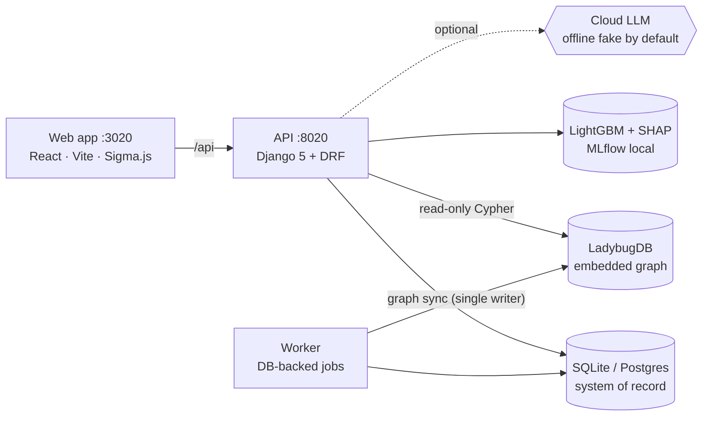

# Kinroot

**Customer due diligence and beneficial ownership for professional firms under AML/CTF rules.**

Australia's Tranche 2 reforms bring lawyers, accountants, conveyancers, real-estate agents and precious-stone
dealers under the AML/CTF Act from **1 July 2026**; UK firms in the same professions work under the Money
Laundering Regulations 2017. Their hardest CDD question is structural: *who really owns or controls this client*
when the client is a trust over a company over an offshore holding company?

Kinroot answers it with an ownership-and-control graph, explainable entity resolution, sanctions/PEP screening,
a rules-based risk methodology with a machine-learning second opinion, ongoing monitoring, and case management
with tipping-off controls. It runs entirely on one laptop, offline, with synthetic demo data.

> Status: foundation in place (platform skeleton, contract, data plan, ADRs). Features are being built against
> [`docs/API_CONTRACT.md`](docs/API_CONTRACT.md).

## What it does
- **Onboarding**: individuals, companies, trusts and partnerships; identity checklist, consent, mocked electronic verification.
- **Ownership graph**: ultimate beneficial owners (≥ 25% or control) at any date, every path explained in a sentence, cycles detected.
- **Entity resolution**: Fellegi-Sunter baseline and a calibrated LightGBM matcher with SHAP reasons; human merge/split queue.
- **Screening**: sanctions and PEP lists with reasoned match review; re-screening when lists change.
- **Risk**: versioned rules methodology as the decision of record, a LightGBM challenger beside it, EDD triggers and two-stage sign-off.
- **Monitoring**: structure-change alerts, review scheduling, drift checks.
- **Cases**: concerns, investigation cases and suspicious-matter report drafts behind need-to-know access.
- **Investigation assistant**: answers "how is X connected to Y?" by walking the graph and citing every edge.

## Architecture



More: [architecture](docs/ARCHITECTURE.md) · [problem statement](docs/PROBLEM_STATEMENT.md) ·
[data sources](docs/DATA.md) · [ADRs](docs/adr/).

## Quick start

Requirements: Python 3.13, Node 21+, and on macOS `brew install libomp` (LightGBM's OpenMP runtime).

```bash
make setup        # venv + pinned deps, web deps, .env, migrate, seed the demo firm
make dev          # API :8020 + worker + web :3020
```

Open http://localhost:3020 and sign in as `daniel@harbourline.example` (compliance officer) with password
`Kinroot-demo-2025!`. Other demo roles are listed in the contract (Part 5).

| Task | Command |
|---|---|
| Tests · lint · types | `make test` · `make lint` · `make typecheck` |
| Evaluation gates | `make eval` → `eval/RESULTS.md` |
| Retrain models | `make train` |
| Optional public data (OpenSanctions, Companies House sample) | `make data` |
| Reset demo data | `make reset` |

## Screenshots
_Placeholder._

## Measured results
_Placeholder: entity-resolution F1 vs baseline, review-queue rate, challenger AUC/calibration and agreement, UBO
correctness, screening precision (from `eval/RESULTS.md`)._

## Compliance note
Designed to support a firm's obligations under the AML/CTF Act 2006 (Cth) and Rules, the Privacy Act 1988, the
UK MLR 2017 and UK GDPR. It does not make a firm compliant on its own, claims no certification, and is not legal
advice. Demo data is synthetic.

## Licence
MIT for the code. Optional downloaded data keeps its own licence (OpenSanctions CC BY-NC 4.0; Companies House
Open Government Licence v3.0) and is never committed.
