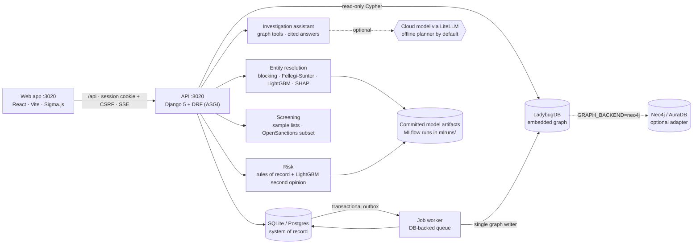
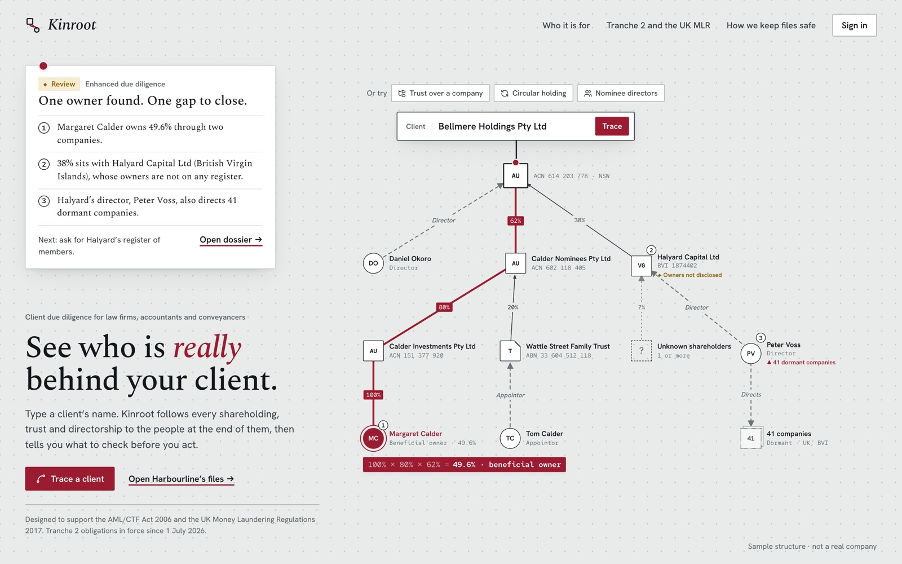
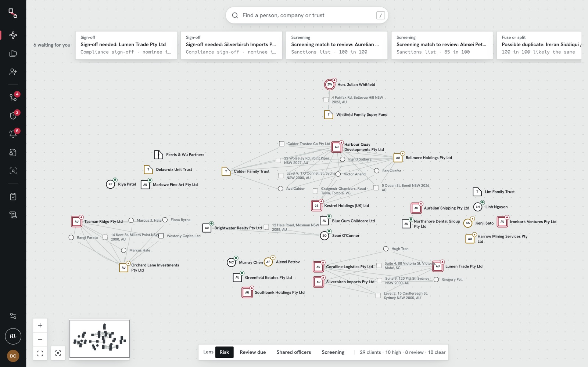
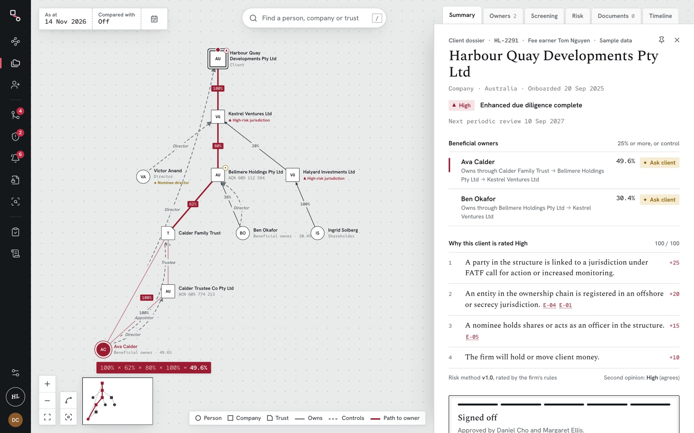
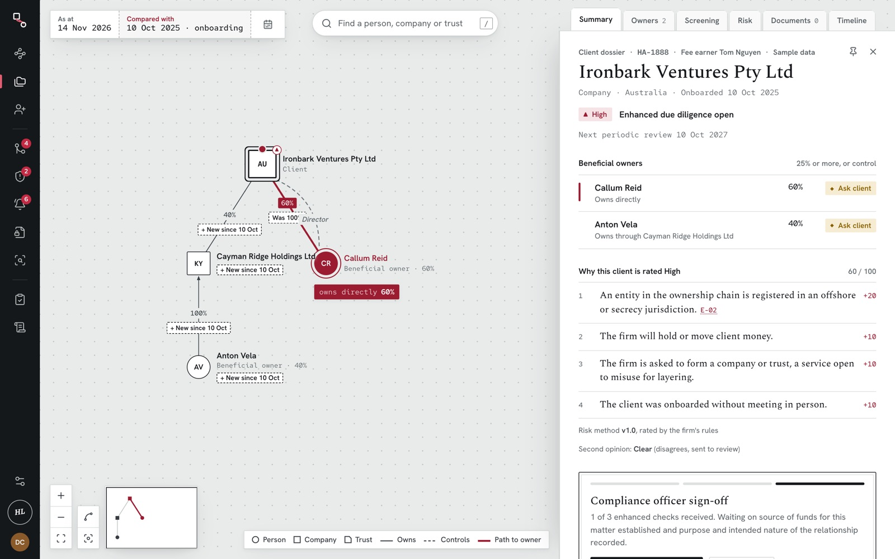
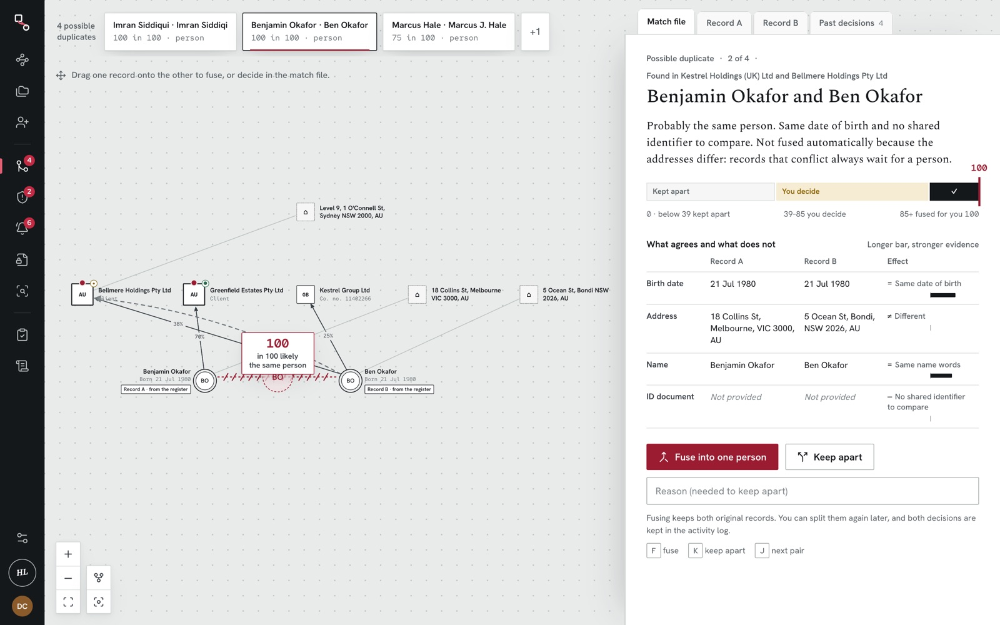
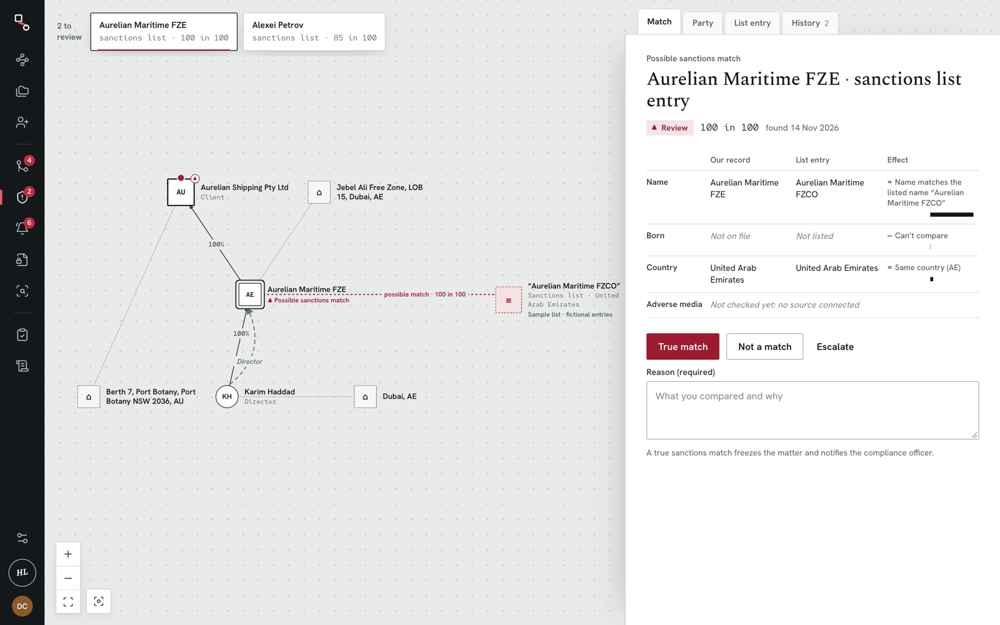
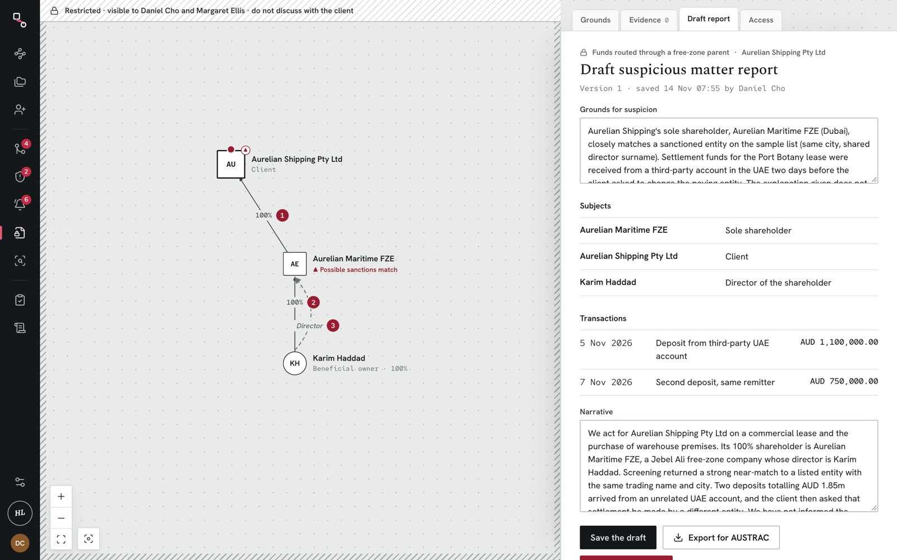
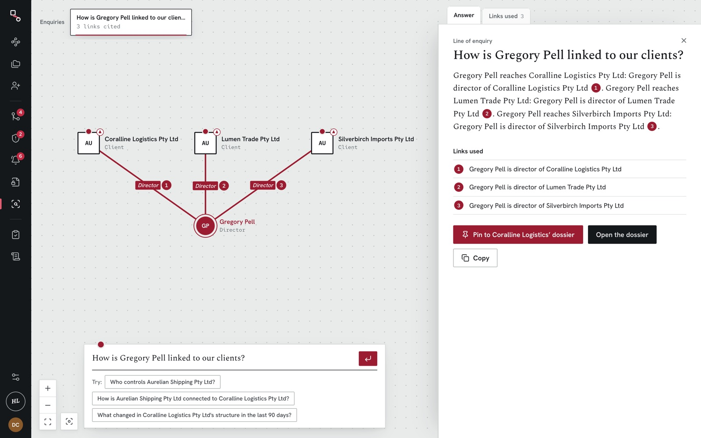

<div align="center">

# Kinroot

**Customer due diligence and beneficial ownership for professional firms under AML/CTF rules.**

Kinroot helps law firms, accountants and conveyancers find out who really owns or controls a client, screen everyone in the structure, rate the risk with reasons a regulator can read, and keep watching after onboarding. Suspicious matters are handled behind tipping-off controls.

[Problem statement](docs/PROBLEM_STATEMENT.md) · [Architecture](docs/ARCHITECTURE.md) · [API contract](docs/API_CONTRACT.md) · [Data sources](docs/DATA.md) · [Design decisions](docs/adr/) · [Evaluation](eval/RESULTS.md)

</div>

---

## Why now

Australia's AML/CTF Amendment Act 2024 brings "Tranche 2" professions under the AML/CTF Act 2006: lawyers,
accountants, conveyancers, real-estate agents, trust and company service providers, and dealers in precious stones
and metals. Their obligations **commence on 1 July 2026**, and AUSTRAC enrolment opens ahead of that date. From
then, a firm must have:

- an AML/CTF program and an AML/CTF compliance officer;
- customer due diligence before it provides a designated service, including the **beneficial owners** (25% or more,
  or control);
- PEP and sanctions checks, enhanced due diligence for high-risk clients and senior approval for PEPs;
- ongoing monitoring, and suspicious-matter reports made **without tipping off** the client;
- records kept for **7 years**.

UK firms in the same professions have worked under the **Money Laundering Regulations 2017** for years, and the
core task is the same.

Most of these firms have never done this work. Their clients are often **structures**, not people: a family trust
whose corporate trustee owns a property company, which is in turn held through an overseas holding company. "Who
really owns or controls this client?" is a graph question. The firm has to answer it, show its working, and check
again when anything changes.

| Instead of | Kinroot does |
|---|---|
| Tracing ownership by hand through PDFs and registry extracts | An **ownership and control graph** that computes ultimate beneficial owners at any date, multiplies percentages through every layer, detects cycles and explains each path in a sentence |
| The same person entered five ways across clients | **Entity resolution** with a calibrated match probability, plain-language reasons and a human fuse-or-split queue |
| Clearing common-name screening alerts with no record of why | **Sanctions and PEP screening** across the whole structure, with every review decision and reason recorded |
| Risk ratings that differ by fee earner | A **versioned rules methodology** as the decision of record, with a **second-opinion model** that flags ratings worth another look |
| Calendar-only reviews | **Monitoring** that re-screens when lists change, alerts on structure changes and schedules reviews by rating |
| Suspicion discussed in email threads | **Need-to-know cases and SMR drafts**: people without access cannot learn that a case exists |

## Features by role

The seeded roles match how a small firm runs its AML/CTF program.

| Role | What they get |
|---|---|
| **AML/CTF compliance officer** (MLRO in the UK) | A file tray of decisions waiting: rating sign-offs, match reviews, screening hits and alerts. The fuse-or-split queue, screening review with recorded reasons, the disagreement queue for the second opinion, the risk methodology (draft and publish versions), model promotion, restricted cases and SMR drafts, the compliance programme dashboard and retention settings |
| **Fee earner** (lawyer, accountant, conveyancer) | Client onboarding for individuals, companies, trusts and partnerships, with an identity checklist, document upload, consent and a demo electronic check. Registry import, a live view of the structure as it fills in, and a one-way "raise a concern" that never reveals the outcome |
| **Partner** (senior manager) | Senior approval for high-risk and PEP clients (a partner cannot approve their own client), the programme view with overdue reviews and high-risk clients, and the board to drill into any structure |
| **Independent reviewer** (auditor) | Read-only access to every client, rating and reason, plus the activity log with a one-click check that no entry has been altered |
| **Firm administrator** | Members, invitations, firm settings, the training register and retention, without access to suspicious-matter reports |

Across all of them:

- **Investigation board.** The client book is a constellation of pins clustered by shared officers, owners and
  addresses. Each client opens into its structure, with the path to each beneficial owner drawn as a red string
  ("100% × 80% × 62% = 49.6%") and a text ledger of the same data for keyboard and screen-reader users.
- **Point in time.** Any structure can be shown "as at" a date, or compared with another date to show what changed
  since onboarding.
- **Investigation assistant.** Ask "how is this person connected to that company?" or "what changed since
  onboarding?". It answers by walking the graph and cites every relationship it used. Answers that cannot be fully
  cited are withheld, and it has no access to cases.

## Quick start (offline, no accounts)

You need Python 3.13 and Node 21.7 (see `frontend/.nvmrc`). On macOS, LightGBM needs the OpenMP runtime:
`brew install libomp`. No Docker, no API keys and no network after setup.

```bash
make setup      # Python venv + pinned deps, web app deps, .env from .env.example, migrate, seed
make seed       # (re)seed the demo firms; idempotent, already run by make setup
make dev        # API :8020 + job worker + web :3020 (Ctrl-C stops all)
```

Open http://localhost:3020 and sign in as **`daniel@harbourline.example`** / **`Kinroot-demo-2025!`** (AML/CTF
compliance officer).

The demo firm is **Harbourline Legal (Sydney)**. Every account uses the same password:

| Account | Role |
|---|---|
| `daniel@harbourline.example` | AML/CTF compliance officer |
| `margaret@harbourline.example` | Partner (senior approval) |
| `tom@harbourline.example`, `aisha@harbourline.example` | Fee earners |
| `ruth@harbourline.example` | Independent reviewer (read only) |
| `olivia@harbourline.example` | Firm administrator |
| `priya@northgate.example` | Compliance officer at **Northgate Accountants (London)**, a separate UK firm used for MLR 2017 flows and tenant isolation |

Harbourline has 30 synthetic clients built to exercise the hard cases:

- **Harbour Quay Developments:** a trust over a company over an offshore holding company. The beneficial owners
  are Ava Calder (49.6% plus control as appointor) and Ben Okafor (30.4%).
- **Tasman Ridge:** a three-company ownership cycle.
- **Lumen Trade, Silverbirch, Coralline:** a nominee-director cluster. One director also directs 41 dormant companies.
- **Aurelian Shipping:** a likely sanctions near-match, with an open restricted case and an SMR draft.
- **Alexei Petrov:** a sanctions name match that is a false positive (different birth year and nationality).
- **Hon. Julian Whitfield:** a confirmed PEP awaiting senior approval.
- Duplicate people to fuse, split or keep apart, a company limited by guarantee, a unit trust, an undisclosed 30%
  holder, an ownership change through a Cayman entity, and overdue reviews.

All dates are relative to the day the seed runs.

**Optional real data.** `make data` downloads small subsets of OpenSanctions (AU, UK and UN sanctions; AU and UK
parliament PEPs) and one part of the Companies House PSC snapshot into the git-ignored `data/` folder (about 120 MB
transferred, about 50 MB kept). Set `SANCTIONS_SOURCE=opensanctions` to screen against the real lists as well as
the sample.

**Cloud assistant answers (optional).** Install `pip install -e "backend[ai]"`, set `LLM_FAKE=false` and a free-tier
key (`GROQ_API_KEY` or `GEMINI_API_KEY`). By default the assistant uses a deterministic offline planner over the
same graph tools.

## Architecture



- **Django is the system of record; the graph is a projection** ([ADR 0002](docs/adr/0002-system-of-record-and-graph-sync.md)).
  Relationships carry validity dates and are ended, not deleted, which gives "as at" answers. Model signals write
  a transactional outbox, and the worker is the single read-write owner of the graph file. The API reads through a
  read-only handle that reopens when the graph version moves. The whole projection can be rebuilt from Django.
- **Embedded graph with portable Cypher** ([ADR 0001](docs/adr/0001-embedded-graph-ladybugdb.md)). LadybugDB, the
  maintained fork of Kùzu, runs in-process with no server. Every query follows portability rules learned from a
  smoke test (hop-by-hop traversal, simple paths assembled in Python, bounded depth), so the same Cypher runs on
  Neo4j through the adapter.
- **UBO engine.** Effective ownership is the sum over simple paths of the product of percentages. Control roles
  (trustee, appointor, protector, significant control, nominee principals) make a beneficial owner regardless of
  percentage. Ownership lost to a cycle, an undisclosed holder or the depth limit is reported as unexplained, so
  traced plus unexplained always adds up to 100%.
- **Rules decide, the model advises** ([ADR 0004](docs/adr/0004-rules-of-record-ml-challenger.md)). The rating of
  record comes from a versioned points methodology (`KR-RM-x.y`). Every point carries a reason and the ids of the
  graph evidence behind it.
- **Tipping-off controls** ([ADR 0005](docs/adr/0005-tipping-off-controls.md)). Cases need `smr:read` and a place
  on the case's access list. Everyone else gets a 404, never a 403, and case counts, events, audit rows and assistant
  answers are filtered. Actions that could alert the client are held with a neutral `409 action_held`.
- **Platform.** Argon2id passwords; server-side sessions with 30-minute idle and 12-hour absolute expiry; CSRF;
  throttles; security headers; RFC 7807 errors; tenant isolation on every query and every graph node; a
  per-organisation SHA-256 hash-chained audit log; `/health`, `/health/ready` and Prometheus `/metrics`.

## Tech stack

| Area | Technology |
|---|---|
| API | Python 3.13, Django 5, Django REST Framework, uvicorn (ASGI, for the SSE stream), structlog, Prometheus client |
| Data | SQLite by default; Postgres supported (`backend[postgres]`, `SKIP LOCKED` job claims) |
| Graph | LadybugDB (embedded, Cypher); optional Neo4j / AuraDB adapter (`backend[neo4j]`) |
| Jobs and events | DB-backed job queue with leases and retries, an event outbox and Server-Sent Events (no Redis) |
| Matching and screening | rapidfuzz, jellyfish (Jaro-Winkler, Double Metaphone, NYSIIS), custom normalisation and blocking |
| Classical ML | scikit-learn, LightGBM, Optuna, SHAP (exact TreeSHAP), isotonic calibration, MLflow (local tracking and registry) |
| Assistant | Six permission-checked tools over the graph, screening and risk records; a deterministic offline planner; optional LiteLLM (Groq, Gemini) |
| Web | React 19, Vite, React Router, TanStack Query, Sigma.js 3 + graphology (ForceAtlas2), Motion, Tailwind CSS 4.1 |
| Quality | pytest, Ruff, mypy (Django and DRF plugins), ESLint, Vitest, an evaluation harness with gates, GitHub Actions CI |

## Machine learning

Two classical models sit at the core, both trained locally on CPU, tracked in MLflow, documented in model cards
([matcher](backend/artifacts/models/er/model_card.md), [risk](backend/artifacts/models/risk/model_card.md)) and
gated in CI by `make eval`. Neither one acts alone: the matcher's uncertain middle goes to a person, and the risk
model only opens a review.

### Entity resolution: is this the same person or company?

**Pipeline** ([ADR 0003](docs/adr/0003-ml-entity-resolution.md)):

1. **Normalise:** case-fold, transliterate to ASCII, strip honorifics and legal suffixes, parse partial birth dates,
   canonicalise ACN/ABN and UK company numbers.
2. **Block:** pairs must share one of nine cheap keys (identifiers, phonetic surname and birth year, postcode and
   initial…).
3. **Compare:** 15 features (name similarity, phonetic agreement, birth-date agreement, identifier and address
   agreement).
4. **Score:** a Fellegi-Sunter baseline beside the trained models.

**Data.** Labelled pairs are built from **real Companies House PSC records** (birth month and year, nationality,
locality), perturbed with typos, initials, transliterations, swapped name order, missing fields and date slips. They
are mixed with synthetic Australian people and companies, and hard negatives are added on purpose: namesakes,
relatives at one address, sibling companies. Splits are **by entity**, so no person or company appears in both
training and test. Only features, labels and coarse origin groups leave the git-ignored `data/` folder.

Held-out test fold: 39,142 blocked pairs, 6,689 true matches.

| Model | Precision | Recall | F1 | Avg precision | Brier | ECE | Review-queue rate |
|---|---|---|---|---|---|---|---|
| Fellegi-Sunter (EM, unsupervised) | 0.8861 | 0.9232 | 0.9042 | 0.9546 | 0.0401 | 0.0408 | - |
| Logistic regression (calibrated) | 0.9782 | 0.9816 | 0.9799 | 0.9973 | 0.0055 | 0.0013 | 0.0532 |
| Random forest | 0.9823 | 0.9883 | 0.9853 | 0.9986 | 0.0044 | 0.0035 | - |
| **LightGBM (calibrated, champion)** | 0.9732 | **0.9928** | 0.9829 | 0.9985 | 0.0044 | **0.0013** | **0.0368** |

The precision, recall and F1 columns use each model's own cut-off: the best-F1 cut on validation for the
baselines, 0.5 for LightGBM. Random forest is level with LightGBM on the threshold-free numbers. LightGBM is the
champion because it has the highest recall, is calibrated with isotonic regression, keeps monotone constraints on
the name-similarity features, explains each pair with exact TreeSHAP, and ships as a small text file. It was tuned
with Optuna (40 trials).

**Operating point** (thresholds chosen on the validation precision-recall curve):

- **Auto-merge** at p ≥ 0.8478, and only when there is no conflicting full birth date, registration number or
  address. Auto-merge precision is **0.9914**, and 81% of true matches merge without a person.
- **Review** from p ≥ 0.3902. Recall at the review threshold is **0.9973**, and 3.7% of blocked pairs go to the
  queue.
- **Reject** below that.
- **Reasons:** each pair shows its five largest SHAP contributions in plain words ("Same date of birth",
  "Different company numbers"). Every merge can be split again.

### Risk second opinion: does this rating deserve another look?

The rules rating is the decision of record. A LightGBM model scores the same rule and graph features (layers to the
beneficial owner, offshore and high-risk jurisdictions, nominee indicators, shared officers, unexplained ownership,
screening hits). It estimates the probability that a relationship later needs enhanced action. When it disagrees
with the rules by a band and its probability sits clearly on the other side of its threshold, the client goes to
the compliance officer's disagreement queue: keep the rules, override with a reason, or flag a methodology issue.

Latest onboarding cohort, held out by time: 5,126 synthetic clients, outcome rate 0.0997.

| Model | ROC-AUC | Avg precision | Brier | ECE |
|---|---|---|---|---|
| Rules methodology score (decision of record) | 0.8544 | 0.5555 | - | - |
| Logistic regression | 0.8713 | 0.6363 | 0.0526 | 0.0079 |
| **LightGBM (calibrated, `rc-1.0`)** | **0.8754** | **0.6694** | **0.0499** | 0.0106 |

- **Agreement with the rules rating: 0.768.** The disagreement queue holds 4.6% of clients.
- **Where the model rated higher than the rules,** 65% of clients had the adverse outcome, against a 10% base rate.
- **Random forest** (0.8703 ROC-AUC) is in the model card.
- **The labels are synthetic.** The model shows the pipeline and controls a real deployment needs, and should be
  retrained on a firm's own reviewed outcomes before it is relied on.

### Fairness and stability

- **Matching works across naming conventions.** Name origin is never a feature. Recall at the review threshold is
  1.0 for Anglo, Arabic, Chinese, Korean/Japanese, Mediterranean, South Asian and Vietnamese names, and 0.998 for
  real register records. The gap across groups is 0.0018 (gate: ≤ 0.05).
- **The second opinion does not single out nationality.** Nationality, sex and age are never features; they are used
  only to test. High-flag rates are 0.070 for clients born in the country and 0.057 for clients born overseas, a
  ratio of 0.81 (gate: ≥ 0.6).
- **By age band,** individual clients are almost never flagged high and entities are (0.12). This tracks the outcome
  rates (0.15 for entities, about 0.04 for individuals) and is reviewed at each retraining.
- **Rules are monotonic.** There were 0 violations in 8,000 checks: adding a risk factor never lowers the score.
- **Outputs are reproducible.** Identical inputs give identical scores (an `inputsHash` is stored), and irrelevant
  fields are ignored.
- **The second opinion is stable.** Under an irrelevant perturbation, the mean probability changes by 0.004 and
  0.29% of ratings flip (gate: ≤ 2%).
- **Drift is monitored.** PSI on ten inputs and on the score is checked against the training reference once 50
  clients are assessed. A new version becomes champion only when the compliance officer promotes it with a recorded
  reason.

## Measured results

### Evaluation gates (`make eval`, offline, all passing)

| Gate | Result |
|---|---|
| Matcher F1 vs Fellegi-Sunter | 0.9829 vs 0.9042 (gate: baseline + 0.03) |
| Auto-merge precision · recall at review · review-queue rate | 0.9914 · 0.9973 · 0.0368 |
| Matcher calibration (ECE) · blocking recall | 0.0013 · 0.9822 |
| Beneficial ownership on crafted structures | 18 / 18. These cover trusts over companies over offshore holdings, three-company cycles, mutual cross-holdings, diamond paths that cross 25% only together, undisclosed holders, nominees, unit trusts, corporate trustees, a company limited by guarantee, point-in-time changes, six-layer chains and the depth limit, all run on the real embedded graph engine |
| Screening on 50 labelled near-misses | precision 0.9118, recall 1.0 (31 true alerts, 3 false, 0 missed) |
| Risk second opinion | ROC-AUC 0.8754 vs rules 0.8544; ECE 0.0106; agreement 0.768 |
| Fairness and stability | flag-rate ratio 0.81; 0 monotonicity violations; 0.29% flips |
| Assistant citations | 8 / 8: answerable questions cite every ownership edge on the expected paths; restricted or unanswerable ones are withheld |

Snapshot with every table: [eval/RESULTS.md](eval/RESULTS.md).

### Tests and performance

- **Tests:** 434 backend tests (pytest: platform, API, RBAC matrix, tenant isolation, tipping-off, graph, entity
  resolution, screening, risk, monitoring, assistant, models) and 101 web tests (Vitest: API client, fixture
  contract, graph transforms and layout, key journeys). Ruff, mypy (Django/DRF plugins), ESLint and `tsc` are clean.
- **End-to-end:** every main journey driven in a real browser against the production web build, the API and the
  worker, signed in as each demo role, with motion on and with reduced motion: no console errors, no failed
  requests, no horizontal overflow at 390 px.
- **Speed** (one laptop, SQLite + embedded graph, warm API, signed in as the compliance officer, 40 calls each):

| Request | p50 | p95 |
|---|---|---|
| Home (`/dashboard`) | 13 ms | 14 ms |
| Client book, 50 per page | 36 ms | 37 ms |
| Client structure graph | 8 ms | 9 ms |
| Beneficial owners with explained paths | 6 ms | 7 ms |
| Pull the thread (a person to every client) | 6 ms | 6 ms |
| Whole-book constellation | 28 ms | 30 ms |
| Assistant question (offline, cited) | 11 ms | 52 ms |

  Inside the graph layer a beneficial-owner calculation takes about 2 ms (four layers with a trust, or a circular
  holding) and the whole 29-client book about 36 ms. A full `make reset` (drop, migrate, seed both firms with
  graph projection, duplicate detection, screening, risk and monitoring) takes about 6 s, of which the seed is
  1.2 s. `make train` retrains both models from fixed seeds in about 2.5 minutes on CPU (147 s; Optuna, 40 trials each) and reproduces the committed artifacts byte for byte.

CI runs lint, mypy, a migrations check, the graph smoke test, the backend tests with coverage, the offline seed,
the evaluation gates, and the web typecheck, lint, tests and production build.

## Screenshots

All screens use the synthetic Harbourline sample firm. Images live in [`docs/screenshots/`](docs/screenshots/).

| | |
|---|---|
|  |  |
| **Trace a client.** The landing page is the product: type a name, watch the owners unfold, see the path to the beneficial owner. | **The client book.** Every client a pin, clustered by shared directors, owners and addresses; the next decisions wait in the tray. |
|  |  |
| **Who really owns this client.** Each reason for the rating cites the link it rests on (`E-04`, `E-01`). | **What changed since onboarding.** New, ended and changed links are tagged on the board. |
|  |  |
| **Fuse or split.** Likely duplicates with plain reasons; anything that conflicts waits for a person. | **Screening review.** A possible sanctions match compared field by field; every decision needs a reason. |
|  |  |
| **Suspicious-matter reports.** Restricted to the people on the case, so nobody tips off the client. | **Ask the board.** Answers come only from traced paths, and every link they use is numbered and drawn. |

## Compliance alignment

Kinroot is **designed to support** a firm's AML/CTF program. It does not make a firm compliant on its own, claims no
certification, is not endorsed by AUSTRAC or any UK supervisor, and is not legal advice.

| Obligation | How Kinroot supports it |
|---|---|
| Customer due diligence before a designated service (AML/CTF Act 2006 (Cth) and Rules; UK MLR 2017 reg 28) | Onboarding checklist per client type, identity documents, consent and a demo electronic check. A client cannot be submitted while checklist items are missing |
| Beneficial owners: 25% or more, or control | Graph-based UBO computation through every layer, control roles, nominee pass-through, unexplained ownership shown explicitly, and a senior managing official recorded when nobody qualifies |
| PEPs, sanctions, enhanced due diligence and senior approval (UK MLR regs 33 and 35) | Screening of every party in the structure with reasoned decisions, EDD triggers from the rules, and two-stage sign-off by the compliance officer and a partner |
| A documented, explainable risk methodology | Versioned rules with points, bands and mandatory floors. Every reason cites graph evidence; publishing a version is audited |
| Ongoing customer due diligence | Re-screening when lists change, alerts on ownership and officer changes, and reviews scheduled by rating |
| Suspicious-matter reporting and tipping-off (AML/CTF Act s123; POCA 2002 s333A) | Need-to-know cases, SMR drafts with deadlines, 404 for anyone not on the access list, and neutral holds on client-facing actions. Submission is simulated (`DEMO-SMR-…` reference) |
| Record keeping (7 years AU; at least 5 years under UK MLR reg 40) | Retention preview with the date each record becomes disposable, legal holds, and a confirmed disposal that anonymises personal data while the audit chain stays intact |
| Program governance, compliance officer and training | Role-based access, a compliance programme dashboard, a training register and an independent reviewer role |
| Privacy Act 1988 (APPs) and UK GDPR | Tenant isolation, least-privilege roles, uploads stored outside any served path, a tamper-evident audit log and a per-firm data-residency label (AU or UK). The optional cloud assistant receives only graph facts, never documents |

## Data sources and licences

| Source | Use | Licence |
|---|---|---|
| [OpenSanctions](https://www.opensanctions.org/) (optional download) | AU DFAT, UK FCDO and UN Security Council sanctions; AU federal and NSW and UK parliament PEPs | **CC BY-NC 4.0.** Sanctions and PEP data: OpenSanctions (opensanctions.org). Free for non-commercial use with attribution; commercial use needs a licence from OpenSanctions |
| UK Companies House PSC snapshot (optional download) | Matcher training pairs and UK registry import mapping | Contains public sector information licensed under the **Open Government Licence v3.0** |
| Bundled sample lists and registries | 60 fictional sanctions and PEP entries (`SAMPLE-SAN-*`, `SAMPLE-PEP-*`) and fictional AU and UK registry entries | Part of this repository |

Downloaded data stays in the git-ignored `data/` folder and is never committed. Register records name real people,
so they stay local and never appear in screenshots. Details: [docs/DATA.md](docs/DATA.md).

## Limitations

- **Risk labels are synthetic.** The second-opinion model is trained on generated client outcomes with realistic
  base rates and noise. Its numbers show the method and the controls, not real-world predictive power.
- **The ABN Lookup adapter is a mock.** AU registry search reads a bundled fictional registry. A live client needs an
  ABR GUID and is not included; `scripts/fetch_abn.py` can save real responses to check the mapping. There is no
  Companies House REST client either: UK imports use the bundled structure or the downloaded PSC sample.
- **The Neo4j adapter has not been tested against a live server.** The queries follow the portability rules and
  the adapter implements the same interface, but CI exercises LadybugDB only.
- **The cloud assistant path is tested only with mocks.** The offline planner is what the evaluation measures. The
  LiteLLM path has unit tests with a mocked client and has not been run against a live provider. Drafts that fail
  the citation check fall back to the offline answer.
- **The matcher's labels are constructed.** The register publishes birth month and year only, so day-level date
  features are tested on synthetic variation. Real duplicates can be messier (aliases, other transliteration schemes,
  shared corporate service addresses).
- **UK structures from the PSC sample are one layer deep.** Deep chains, trusts and cycles come from the synthetic
  seed.
- **Screening precision is measured on 50 labelled cases** against the bundled fictional lists. Adverse media is a
  placeholder and is not connected.
- **Identity verification and SMR submission are simulated.** No government document service and no AUSTRAC or NCA
  portal are called.
- **CI runs on SQLite only.** Postgres is supported by the job queue and settings, but CI does not exercise it.

## Project layout

```
backend/         Django project
  kinroot/         settings, core (errors, middleware, logging, metrics, throttling), shared contracts, URLs
  api/             DRF views, serializers, auth, SSE stream
  accounts/        users, firms, memberships, roles and permissions, invitations, settings, training register
  audit/           per-firm hash-chained audit log
  jobs/            DB-backed job queue, worker command, event outbox
  clients/         system of record: clients, parties, relationships, onboarding, EDD, holds, registry import,
                   retention, demo seed
  cases/           concerns, need-to-know cases, SMR drafts
  graph/           graph store (LadybugDB, Neo4j adapter), outbox sync, Cypher repository, UBO and path algorithms
  resolution/      normalisation, blocking, features, Fellegi-Sunter, LightGBM matcher, reasons, training (ml/)
  screening/       sample lists, OpenSanctions loader, matcher, attribution
  risk/            rules methodology, features, second-opinion model, training (ml/), model registry
  monitoring/      alerts, review schedule, daily run
  assistant/       graph tools, offline planner, optional LiteLLM adapter
  artifacts/models/  committed matcher and risk models, thresholds, calibrators, model cards
  tests/           platform, API, graph, domain and ML tests
frontend/        React + Vite investigation board (see frontend/DESIGN.md)
eval/            evaluation harness (run.py), gates, held-out fixtures and RESULTS.md
scripts/         OpenSanctions, Companies House and ABN downloaders, graph smoke test, clean
docs/            problem statement, architecture, API contract, data sources, ADRs
```

## Make targets

| Target | What it does |
|---|---|
| `make setup` | Create the Python 3.13 venv, install pinned backend and web dependencies, create `.env`, migrate and seed |
| `make seed` / `make reset` | Seed the demo firms (idempotent) / drop local data (SQLite and graph), migrate and seed again |
| `make dev` | API on :8020 + job worker + Vite dev server on :3020 (Ctrl-C stops all) |
| `make api` / `make worker` / `make web-dev` | Run one process |
| `make web` | Production build of the web app, served on :3020 |
| `make migrate` / `make makemigrations` | Apply / create database migrations |
| `make test` | Backend tests + web typecheck, unit tests and production build (`make test-backend`, `make test-frontend` run one part) |
| `make lint` / `make typecheck` | Ruff + ESLint / mypy + tsc |
| `make eval` | Evaluation gates for matching, ownership, screening, risk, stability and the assistant → `eval/RESULTS.md` |
| `make train` | Retrain the matcher and the risk model on CPU, tracked in `mlruns/`. Run `make data` first to reproduce the committed matcher, which was trained with the Companies House sample |
| `make data` | Download the optional OpenSanctions and Companies House subsets into `data/` |
| `make graph-smoke` | Re-verify the embedded graph engine (ADR 0001) |
| `make lock` | Re-resolve and freeze backend dependencies into `backend/requirements.lock` |
| `make clean` | Remove caches and build output (keeps `data/` and the venv) |
| `make help` | List every target |

## Licence

MIT for the code. Downloaded data keeps its own licence (OpenSanctions CC BY-NC 4.0; Companies House Open
Government Licence v3.0). All firms, people and clients in the demo are synthetic.
