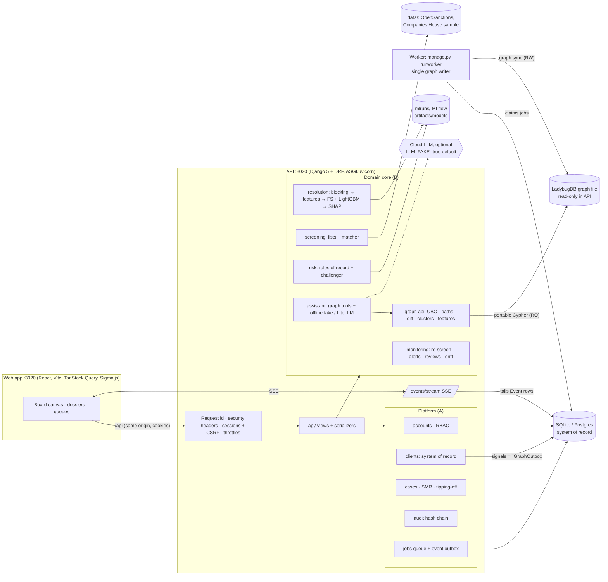

# Kinroot architecture

Kinroot is a modular Django monolith with an embedded property graph beside the relational system of record,
a DB-backed job worker, classical ML for entity resolution and a risk challenger, and a React web app.
Everything runs on one laptop with no servers beyond the API and the worker.

## Request path
1. The browser talks only to `:3020`; Vite proxies `/api` to `:8020`, so session and CSRF cookies are first-party.
2. `RequestContextMiddleware` assigns `X-Request-ID`, binds it to structured logs and records Prometheus metrics;
   `SecurityHeadersMiddleware` sets CSP, `nosniff`, frame and referrer policies and `no-store` on API JSON.
3. DRF authenticates the session (`SessionAuthentication`, CSRF enforced), resolves the active organisation from
   the membership, checks the endpoint permission (`accounts/roles.py`) and applies throttles.
4. Views call the domain core only through `<app>/api.py` and serialise dataclasses from `kinroot/contracts.py`.
5. Errors leave as RFC 7807 problem details with a stable `code`.

## Data and consistency
- **System of record**: Django models (Part 2 of the contract). Relationships carry validity dates and are ended
  rather than deleted, which gives point-in-time answers.
- **Graph projection** (ADR 0001, 0002): signals write a transactional outbox; the worker is the single
  read-write owner of the LadybugDB file and applies the outbox in order; the API reads through a read-only
  handle reopened when `graph_version` changes. `rebuild_org` recreates the projection from Django.
- **Jobs**: `jobs.Job` rows claimed with compare-and-set (SQLite) or `FOR UPDATE SKIP LOCKED` (Postgres), leased,
  retried with backoff. **Events**: `jobs.Event` rows; the SSE endpoint tails them by id, so the worker process can
  notify browsers without Redis.
- **Audit**: per-organisation SHA-256 hash chain; restricted (case) rows stay in the chain but are listed only to
  case-cleared users.

## Domain core
- **UBO engine**: hop-by-hop upstream fetch (portable Cypher), simple-path enumeration in Python, effective
  ownership = Σ over simple paths of Π pct; control roles make a UBO regardless of %; cycles detected and
  reported; plain-language path sentences.
- **Entity resolution** (ADR 0003): blocking → similarity features → Fellegi-Sunter baseline and calibrated
  LightGBM champion → thresholds from the PR curve → SHAP reasons → merge/split queue with human decisions.
- **Screening**: sanctions/PEP lists (bundled fictional sample by default, OpenSanctions subset optional) matched
  with the same name/date features; hits reviewed with reasons; re-screen on list updates.
- **Risk** (ADR 0004): versioned rules methodology is the decision of record; LightGBM challenger (logistic
  baseline) with SHAP; disagreements to review; EDD triggers and two-stage sign-off.
- **Monitoring**: list-update re-screens, structure-change alerts from graph sync, review scheduling by rating,
  PSI drift on model inputs.
- **Assistant**: deterministic planner over six graph tools when `LLM_FAKE=true`; LiteLLM model chain otherwise.
  Every sentence cites graph edges/nodes; ungrounded drafts are withheld. No access to case data (ADR 0005).

## Security and compliance controls
Argon2id passwords; 30-minute idle / 12-hour absolute sessions with rotation on refresh; CSRF on all unsafe
methods; per-user and per-IP throttles; strict security headers; tenant isolation on every query and every graph
node; least-privilege roles; tipping-off controls (ADR 0005); 7-year (AU) / 5-year (UK) retention with legal
hold and dry-run disposal; uploads size- and type-checked and stored outside any served path; secrets only from
environment variables. Designed to support the AML/CTF Act 2006 (Cth) and Rules (Tranche 2 obligations commence
1 July 2026), the Privacy Act 1988 (APPs), the UK MLR 2017 and UK GDPR; no certification is claimed.

## Observability
`/health` (liveness), `/health/ready` (database, graph backend, assistant mode), `/metrics` (Prometheus: HTTP,
throttles, audit appends, jobs, graph query latency and sync lag, ER decisions, screening hits, disagreements,
assistant answers). Structured logs carry the request id.

## Runtime footprint
API (uvicorn) + worker + Vite dev server; SQLite and the graph file in `data/`; Python venv about 620 MB;
LightGBM needs the OpenMP runtime on macOS (`brew install libomp`). Training runs one job at a time on CPU.
